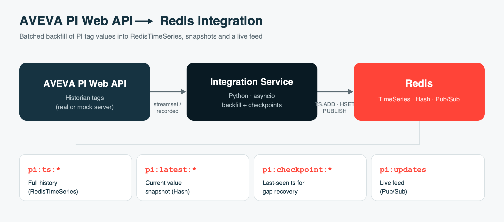

# AVEVA PI Web API → Redis Integration (POC)

A small async service that polls the **AVEVA PI Web API** for time-series tag
values and streams them into **Redis** — as RedisTimeSeries history, a
current-value snapshot, and a pub/sub feed.



> 📊 A customer-facing slide deck (with speaker notes) is in
> [`demo/AVEVA-PI-Redis-Demo.pptx`](demo/AVEVA-PI-Redis-Demo.pptx).

**Delivery model:** each cycle batch-reads *recorded* (archived) values for all
tags in **one** streamset request, starting from each tag's **checkpoint** stored
in Redis. On restart it resumes from the checkpoint and backfills the gap — no
data loss, no duplicates (`TS.ADD ON_DUPLICATE LAST`).

## What lands in Redis

For a tag like `Sinusoid`:

| Key / channel        | Type          | Purpose                                  |
|----------------------|---------------|------------------------------------------|
| `pi:ts:Sinusoid`     | TimeSeries    | Full history; labels `source=pi tag=… path=…` |
| `pi:latest:Sinusoid` | Hash          | Latest value, timestamp, quality, units  |
| `pi:checkpoint:Sinusoid` | String    | Last-written sample time (epoch ms) for gap recovery |
| `pi:updates`         | Pub/Sub       | JSON per new sample for live consumers    |

## Quick start (Docker — no PI System needed)

Spins up Redis Stack, a **mock PI Web API**, and the integration service:

```bash
docker compose up --build
```

Then inspect the data:

```bash
# latest snapshot for a tag
docker compose exec redis redis-cli HGETALL pi:latest:Sinusoid

# last 5 samples of history
docker compose exec redis redis-cli TS.RANGE pi:ts:Sinusoid - + COUNT 5

# all PI series at once, by label
docker compose exec redis redis-cli TS.MRANGE - + FILTER source=pi

# watch the live feed
docker compose exec redis redis-cli SUBSCRIBE pi:updates
```

Check health + metrics:

```bash
curl http://localhost:9100/healthz    # {"status":"ok"} / 503 while degraded
curl http://localhost:9100/metrics    # Prometheus: samples_written, poll_errors, pi_up, ...
```

RedisInsight UI (browse the TimeSeries visually): http://localhost:8001

## Run locally without Docker

```bash
python3 -m venv .venv && source .venv/bin/activate
pip install -r requirements.txt
cp .env.example .env

# terminal 1 — mock PI Web API
uvicorn src.mock_pi_server:app --port 8080

# terminal 2 — Redis Stack (needs RedisTimeSeries)
docker run -p 6379:6379 redis/redis-stack-server:7.4.0-v0

# terminal 3 — the integration service
cd src && python main.py
```

## Point at a real PI Web API

Edit `.env`:

```ini
PI_BASE_URL=https://your-pi-server/piwebapi
PI_AUTH_MODE=basic          # or wire up Kerberos in pi_client.py
PI_USERNAME=svc_pi
PI_PASSWORD=•••••
PI_VERIFY_SSL=true
PI_POINTS=\\PISRV01\Sinusoid,\\PISRV01\CDT158
```

The client uses the standard PI Web API endpoints (`/points`, `/streams/{webId}/value`),
so no code changes are needed for the happy path. Production auth for PI is
usually **Kerberos/SPNEGO**; add it in `PIWebAPIClient.__init__` when you move
past the POC.

## Layout

| File                    | Role                                             |
|-------------------------|--------------------------------------------------|
| `src/config.py`         | Env/.env settings                                |
| `src/pi_client.py`      | Async PI Web API client (`resolve_point`, `get_current_value`) |
| `src/redis_writer.py`   | RedisTimeSeries + snapshot + pub/sub writer      |
| `src/main.py`           | Poll loop + graceful shutdown                    |
| `src/mock_pi_server.py` | Fake PI Web API for local testing                |

## Why Redis in front of AVEVA PI

Redis **complements** PI — it does not replace it. PI stays the system of record
and the long-term compressed historian; Redis becomes the low-latency **serving
and real-time layer** that applications talk to instead of hitting the historian
directly. For serving operational data to modern apps, that changes a lot:

| Dimension | Querying PI Web API directly | Serving via Redis |
|-----------|------------------------------|-------------------|
| **Read latency** | Per-request REST call | **Sub-millisecond**, in-memory |
| **Concurrent app clients** | Limited — load lands on PI | **Thousands**, scaled via replicas |
| **Real-time delivery** | Poll / channel subscriptions | Native **Pub/Sub & Streams** push |
| **Data models** | Time-series (OT-specific) | **TimeSeries + JSON + Search + Vector** |
| **Load on OT systems** | Every query taxes the historian | Apps hit Redis; **PI stays protected** |
| **Scaling & deployment** | Vertical; OT-licensed | **Horizontal**, cloud-native, managed |

**Net:** point your dashboards, alerting and ML feature lookups at Redis. They get
speed and real-time push; your historian and PI licensing are shielded from app
traffic; and the same store also does caching, JSON enrichment and vector search —
so there's less infrastructure to run overall.

## Implemented

- **Recorded-value backfill** — reads archived values (`/streamsets/recorded`),
  not just the current value, so no samples between polls are missed.
- **Streamset batching** — all tags read in one request per cycle.
- **Checkpoints + gap recovery** — per-tag last-seen timestamp in Redis; restarts
  resume from the checkpoint and backfill the gap. Deduped via `TS.ADD ON_DUPLICATE LAST`.
- **Observability** — `/healthz` and Prometheus `/metrics` (samples written, poll
  errors, `pi_up`, resolved-point count).

## Still POC → production

- **Auth:** Kerberos/SPNEGO for a real PI Web API (add to `PIWebAPIClient.__init__`);
  ACL/TLS + `requirepass` for Redis.
- **Scale:** shard tags across workers; tune `RECORDED_MAX_COUNT` and poll interval.
- **Downsampling:** RedisTimeSeries compaction rules (`TS.CREATERULE`) for rollups.
- **Alerting:** wire `/metrics` into Prometheus + Alertmanager (stale `pi_last_poll_unixtime`, rising `pi_poll_errors_total`).
